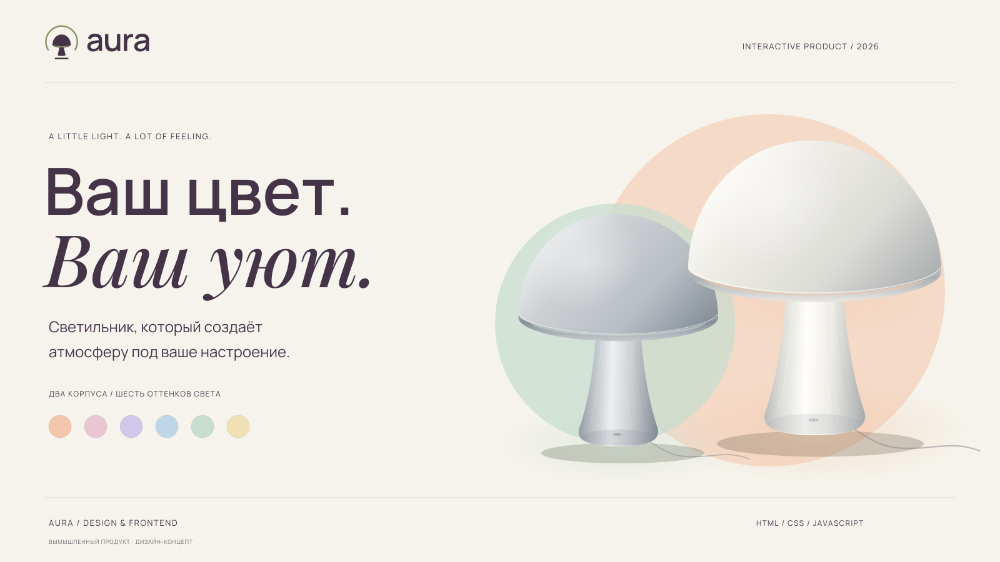

# AURA — ваш цвет. Ваш уют.

Интерактивный лендинг светильника с пастельным освещением. Портфолио-проект объединяет визуальную айдентику, адаптивный интерфейс и motion design.

**[Открыть демо →](https://aura-light-studio.littledawn8.chatgpt.site)** · [Дизайн-система](DESIGN.md) · [Источники и лицензии](THIRD_PARTY.md)



## О проекте

AURA — вымышленный продукт: светильник, цвет освещения которого можно подобрать под себя. Сайт предлагает попробовать свет, выбрать свой вариант и скачать его карточку. Покупка и оплата не предусмотрены.

Обложка выше — композиция из оригинальной графики проекта. Работающий интерфейс доступен по ссылке на демо.

## Что можно попробовать

- Два нейтральных корпуса: молочно-белый и мягкий серый.
- Шесть пастельных оттенков света: персиковый, пудровый, лавандовый, небесный, мятный и сливочный.
- Независимую настройку яркости от 10 до 100% и три готовых сценария.
- Синхронное изменение света на главном экране, в демонстрационной сцене и конфигураторе.
- Сохранение настроек в браузере, сброс и скачивание самостоятельной SVG-карточки.
- Плавные переходы света, параллакс, появление секций и спокойную бегущую строку. Движение можно отключить; системная настройка `prefers-reduced-motion` также учитывается.

## Демо-заказ и страницы

- **[Заявка](https://aura-light-studio.littledawn8.chatgpt.site/order/)** переносит выбранные корпус, цвет света и яркость. В форме используются тестовые имя и Telegram; их значения остаются только в памяти страницы.
- **[Благодарность](https://aura-light-studio.littledawn8.chatgpt.site/thanks/)** появляется после демо-заявки. Прямой переход не выдаёт себя за завершённый заказ.
- **[Конфиденциальность](https://aura-light-studio.littledawn8.chatgpt.site/privacy/)** объясняет работу формы, настроек, хостинга и аналитики.
- **Своя 404** возвращает посетителя к главной странице и световой сцене; хостинг отвечает настоящим HTTP 404.

На главной — пять FAQ и понятные действия «Настроить свет» и «Оставить заявку».
Заявка открывается на отдельной странице; закреплённая нижняя панель убрана.
Текст «Ответим в течение нескольких часов» относится к демонстрационному
сценарию общения в Telegram.

Каждая страница имеет свои H1, title и meta-описание, canonical и Open Graph /
Twitter Card с оригинальным PNG 1200 × 630. Добавлены `robots.txt` и `sitemap.xml`;
страницы благодарности и ошибки не индексируются.

**GA4 подготовлен, но не активирован.** В `dist/site-config.js` идентификатор
счётчика пустой. С настоящим `G-…` сайт запросит согласие до загрузки кода Google;
выбор можно изменить в подвале. Имя, Telegram, пожелания и параметры URL в события
не включаются. Завершение демо помечается `demo_order_complete`, а не покупкой
или реальной заявкой. При текущей конфигурации код Google не загружается.

Служебные страницы можно перегенерировать командой `python3 tools/build-pages.py`,
социальную обложку — `python3 tools/render-social.py` (нужен необязательный CairoSVG).

## Дизайн и интерфейс

Кремовый фон, сливовый текст и редкие лаймовые акценты создают спокойную предметную подачу. Manrope отвечает за интерфейс, курсив Playfair — за смысловые акценты и философские цитаты. Логотип объединяет силуэт светильника и открытый световой ореол.

На ПК конфигуратор показывает настройки рядом с превью, на телефоне занимает весь экран и сохраняет доступ к нижней панели действий. В интерфейсе есть клавиатурное управление, видимый фокус, области нажатия от 44 px и возврат фокуса после закрытия диалога.

Материал корпуса и свечение используют разные CSS-переменные. Яркость и RGB-каналы изменяются одним кадровым циклом с плавным затуханием; при уходе вкладки в фон цикл освобождается.

## Стек

HTML, CSS и JavaScript без фреймворка и сборки. SVG-графика, шрифты и фотография хранятся в репозитории. Для работы сайта не нужны npm-пакеты, API-ключи или серверная часть.

## Локальный запуск

Нужен Python 3. Из корня проекта:

```bash
python3 -m http.server 8080 --directory dist
```

Откройте [localhost:8080](http://localhost:8080). HTTP-сервер нужен в том числе для загрузки SVG при скачивании карточки.

## Структура

```text
dist/          Сайт и локальные ассеты
artwork/       Исходный шаблон светильника
docs/          Обложка портфолио: PNG и исходный SVG
tools/         Генератор обложки
DESIGN.md      Дизайн-токены и правила интерфейса
make-lamps.py  Генератор белого и серого корпусов
make-logo.py   Генератор векторного логотипа
verify.py      Проверка ассетов, ссылок и ARIA-связей
```

## Проверки и графика

Проверки не требуют сторонних Python-пакетов; для синтаксиса JavaScript нужен Node.js:

```bash
node --check dist/app.js
python3 verify.py
```

Чтобы заново создать SVG корпусов:

```bash
python3 make-lamps.py
```

Перегенерация логотипа и обложки — необязательный шаг. Только для этих инструментов нужны `fonttools` и `CairoSVG`:

```bash
python3 -m pip install fonttools CairoSVG
python3 make-logo.py
python3 tools/make-cover.py
```

Авторские инструкции находятся в [AGENTS.md](AGENTS.md). Локальный [Awesome DESIGN.md](.agents/skills/awesome-design-md/SKILL.md) содержит выбранные дизайн-референсы из коллекции VoltAgent с исходными лицензиями и контрольными суммами.
